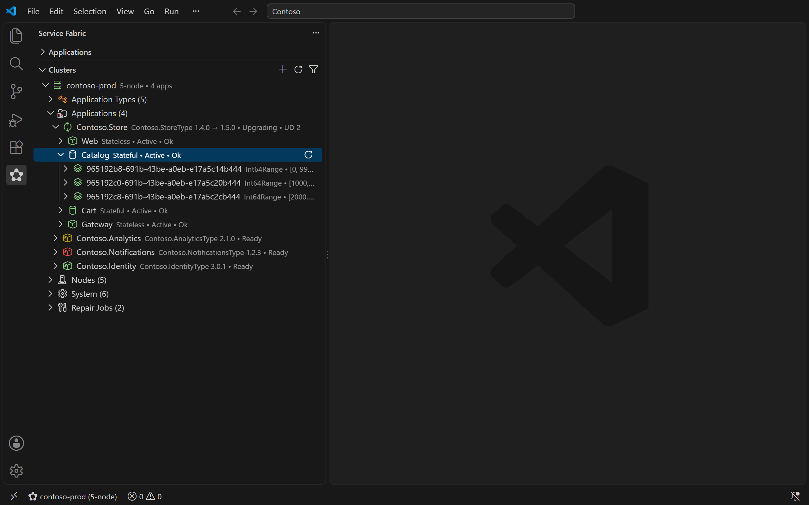
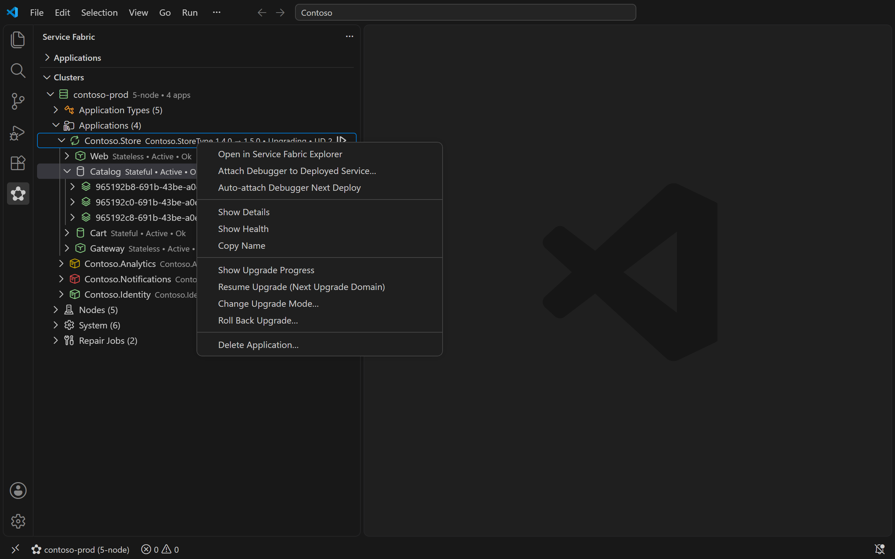
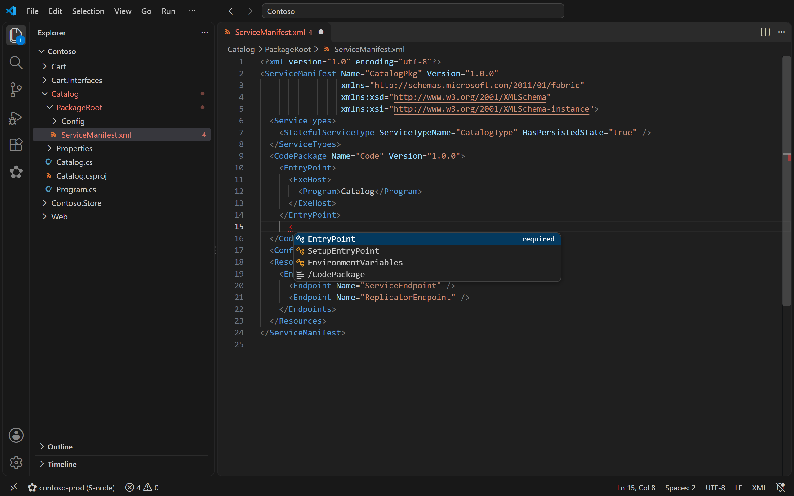
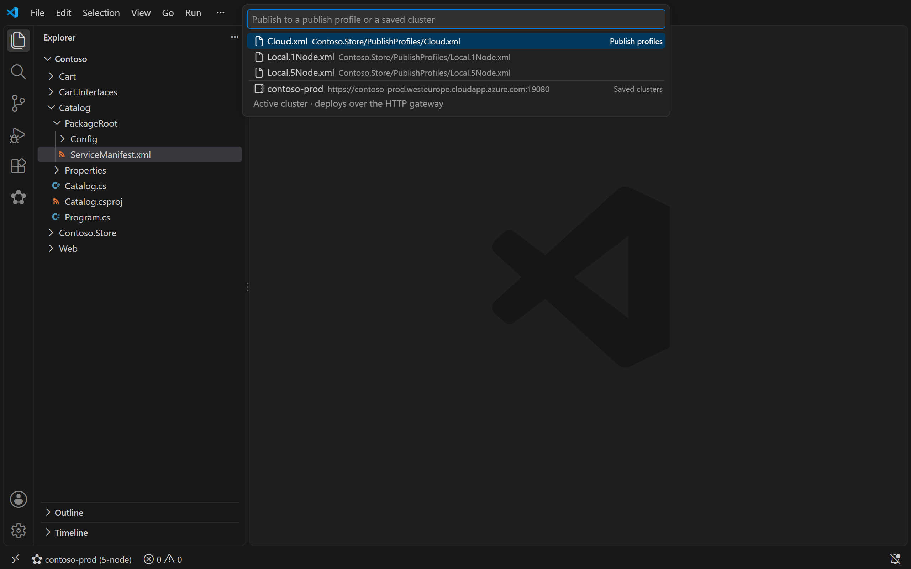
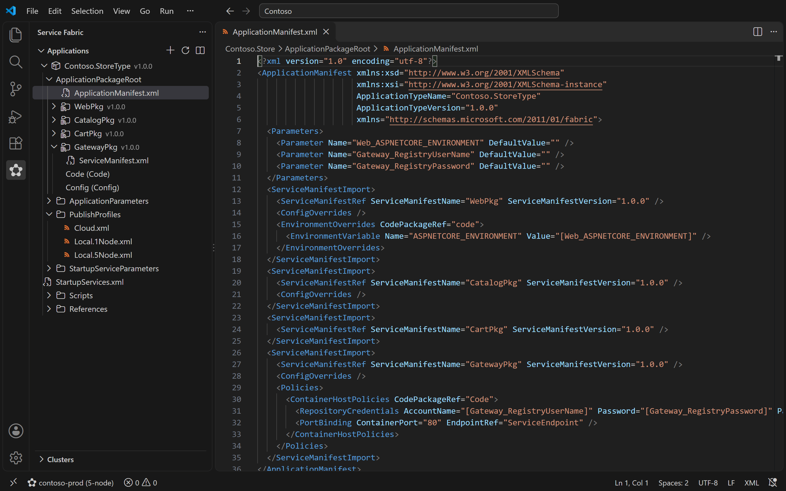

# Service Fabric Tools

Build, publish and debug Azure Service Fabric applications (`.sfproj`) in VS Code on Windows, macOS and Linux, and explore your clusters without leaving the editor.

> This extension is a fork of [Service Fabric Project (sfproj) Tools](https://marketplace.visualstudio.com/items?itemName=sfproj-tools.service-fabric-project-tools-vscode) by **sfproj-tools**, continued from version 1.1.11 under the MIT license. It is not affiliated with or endorsed by Microsoft.

## Features

**Projects and authoring**
- Opens any folder containing a `.sfproj` and shows applications, services, packages, endpoints, parameters and publish profiles in the **Service Fabric** view.
- Built-in manifest IntelliSense: completion, hover docs and schema validation for application and service manifests. No XML extension needed.
- Go to definition between manifests, parameter and version-drift diagnostics, and a "promote literal to parameter" quick fix.
- Encrypt secrets for `IsEncrypted` settings with the cluster's certificate, on any OS.

**Scaffolding**
- Create new applications with the same layout as Visual Studio's template.
- Add stateless, stateful, actor, ASP.NET Core, guest executable and **container** services (.NET or .NET Framework), and add or remove shared library projects.

**Build and publish**
- Build, rebuild, clean and package with MSBuild or `dotnet msbuild`, with NuGet restore built in.
- Publish to a publish profile or straight to a saved cluster, over the cluster's HTTP gateway. No PowerShell or Service Fabric SDK needed.
- Rolling upgrades with automatic version bumping of only the packages that changed.
- Create publish profiles from saved clusters, and build and push container images (Docker, Azure Container Registry).
- Supports `fabric:`, `file:` and Azure Storage (`xstore:`) image stores and compressed packages. The Visual Studio `Deploy-FabricApplication.ps1` flow is still available on Windows.

**Clusters**
- Connect to any number of local and remote clusters: unsecured, certificate-pinned, X.509 client certificate, or Microsoft Entra ID (with Azure CLI sign-in).
- A cluster explorer that mirrors Service Fabric Explorer: application types, applications, services, partitions, replicas, nodes, system services and repair jobs, coloured by health.
- Right-click actions: scale or delete services, restart replicas and code packages, activate or deactivate nodes, read container logs, and resume, change or roll back upgrades in progress.
- Diagnostic events viewer and a status-bar health indicator.

**Local development (Windows)**
- Start, stop, reset and switch the local dev cluster between 1-node and 5-node.
- Attach the .NET debugger to a deployed service, or automatically after each publish.

## Screenshots

**Upgrade controls** for an application that is upgrading:

**Manifest IntelliSense**: completion and hover docs from the Service Fabric schema:

**Publish** to a publish profile or straight to a saved cluster:

**Applications view** and scaffolded manifests:

## Requirements

- VS Code 1.90 or later.
- **Building:** the .NET SDK 8 or later. On Windows, Visual Studio 2022 or its Build Tools also work. .NET Framework services only build on Windows.
- **Local cluster and debugging:** Windows x64 with the Service Fabric SDK, and the [C# extension](https://marketplace.visualstudio.com/items?itemName=ms-dotnettools.csharp) for debugging.
- **Container images:** Docker, plus the Azure CLI for Azure Container Registry.

## Getting started

1. Open a folder containing a `.sfproj`, or run **Service Fabric: Create New Application…**.
2. Add a cluster with the **+** button in the **Clusters** view.
3. Right-click the project and choose **Publish Application…**.

Run **Service Fabric: Get Started** for a walkthrough, or **Service Fabric: Open Help Guide** for the full guide.

If you have the original *Service Fabric Project (sfproj) Tools* installed, disable it: both extensions register the same commands and views.

## Privacy

The extension sends no telemetry.

## Contributing

Issues and pull requests are welcome on [GitHub](https://github.com/williamoconnorme/vscode-service-fabric-tools). See [CONTRIBUTING.md](CONTRIBUTING.md) to get started.

## License

[MIT](LICENSE.txt)
